  

<h1><samp>Rasiol Isufaj</samp></h1>

  <b>Software Engineer · Full-Stack Developer · Student at 42 Paris</b>

  
  

<h2><samp>About me</samp></h2>

  🎓 42 Paris student · MSc in Computer Science 
  💻 Software Engineer focused on Backend Engineering, Full-Stack Development, and System Design 
  🛠️ Experienced in building scalable web applications and low-level systems software 
  💼 Former Full-Stack Developer at EA-TECH and freelance developer on Upwork 
  🎯 Open to 4–6 month Software Engineering internships in Paris

<h2><samp>Featured projects</samp></h2>

<table>
  <tr>
    <td valign="top">
      <h3><a href="https://github.com/rasiolisufaj/42-transcendence"><samp>MesPapiers</samp></a></h3>
      
<i>ft_transcendence</i>: a full-stack platform for French administrative paperwork, with AI-powered document analysis, deadline tracking, automated reminders and real-time community features.

      <ul>
        <li>Led the project as <b>Project Manager</b> and <b>Authentication/Security Lead</b>.</li>
        <li>Built session management, role-based access control (RBAC) and protected API routes, plus real-time features over WebSockets.</li>
      </ul>
      

        
        
        
        
        
        
        
        
        
      

      
<a href="https://github.com/rasiolisufaj/42-transcendence">View repository →</a>

    </td>
  </tr>
  <tr>
    <td valign="top">
      <h3><a href="https://github.com/rasiolisufaj/42-webserv"><samp>WebServ</samp></a></h3>
      
A non-blocking HTTP/1.1 web server written in C++98.

      <ul>
        <li>Engineered an event-driven architecture on <code>epoll</code> to handle concurrent client connections.</li>
        <li>Implemented request parsing, GET/POST/DELETE, file uploads, CGI execution and virtual hosting.</li>
      </ul>
      

        
        
        
        
      

      
<a href="https://github.com/rasiolisufaj/42-webserv">View repository →</a>

    </td>
  </tr>
  <tr>
    <td valign="top">
      <h3><a href="https://github.com/rasiolisufaj/42-inception"><samp>Inception</samp></a></h3>
      
Docker infrastructure and system administration: a secure multi-container WordPress stack.

      <ul>
        <li>Built and configured the NGINX, WordPress/PHP-FPM and MariaDB containers with Docker Compose.</li>
        <li>Set up service networking, persistent storage, configuration and HTTPS/TLS.</li>
      </ul>
      

        
        
        
        
        
      

      
<a href="https://github.com/rasiolisufaj/42-inception">View repository →</a>

    </td>
  </tr>
  <tr>
    <td valign="top">
      <h3><a href="https://github.com/rasiolisufaj/42-minishell"><samp>MiniShell</samp></a></h3>
      
A Unix shell written in C.

      <ul>
        <li>Implemented command parsing, execution, environment variable expansion and built-in commands.</li>
        <li>Handled processes, pipes, redirections, heredocs and signals with Unix system calls.</li>
      </ul>
      

        
        
      

      
<a href="https://github.com/rasiolisufaj/42-minishell">View repository →</a>

    </td>
  </tr>
</table>

<h2><samp>Tech stack</samp></h2>

<h3><samp>Languages</samp></h3>

  
  
  
  
  
  
  
  

<h3><samp>Frameworks &amp; Libraries</samp></h3>

  
  
  
  
  
  
  

<h3><samp>Databases</samp></h3>

  
  
  

<h3><samp>Tools &amp; DevOps</samp></h3>

  
  
  
  
  

